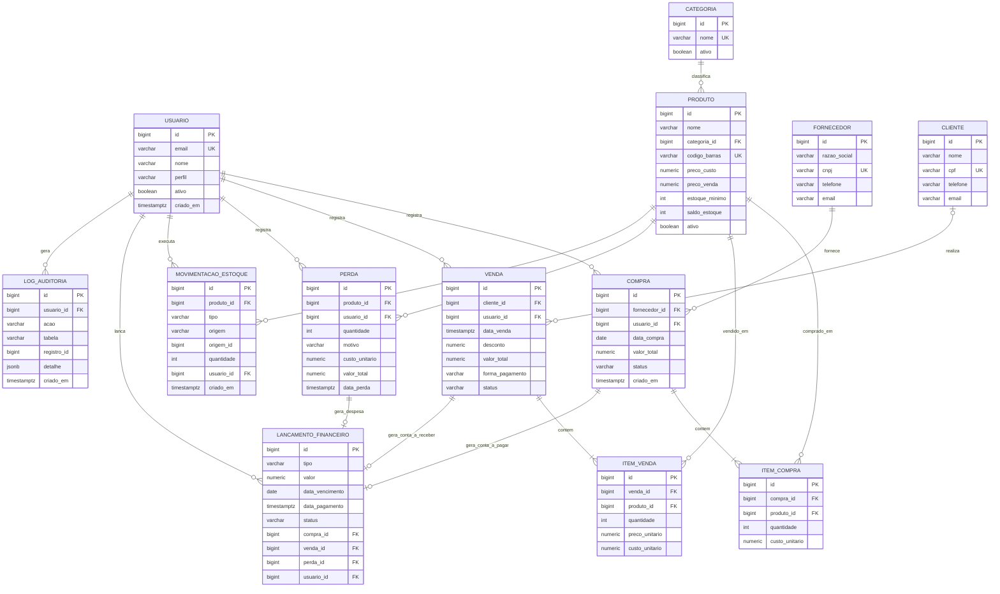

# MER - FarmaCore

Diagrama entidade-relacionamento (notação Mermaid). Para visualizar: cole o bloco em https://mermaid.live ou abra o arquivo no GitHub, que renderiza automaticamente.

## Como a integração aparece no modelo

| Operação | Tabelas afetadas |
|---|---|
| Confirmar compra | `compra` + `item_compra` → `movimentacao_estoque` (ENTRADA) → `produto.saldo_estoque` sobe → `lancamento_financeiro` (PAGAR) |
| Confirmar venda | `venda` + `item_venda` → `movimentacao_estoque` (SAIDA) → `produto.saldo_estoque` cai → `lancamento_financeiro` (RECEBER) |
| Registrar perda | `perda` → `movimentacao_estoque` (SAIDA) → `produto.saldo_estoque` cai → `lancamento_financeiro` (DESPESA) |
| Cancelar compra/venda | status vira CANCELADA, nova `movimentacao_estoque` de estorno e lançamento CANCELADO; nada é apagado |
